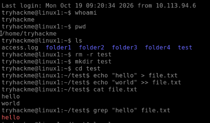
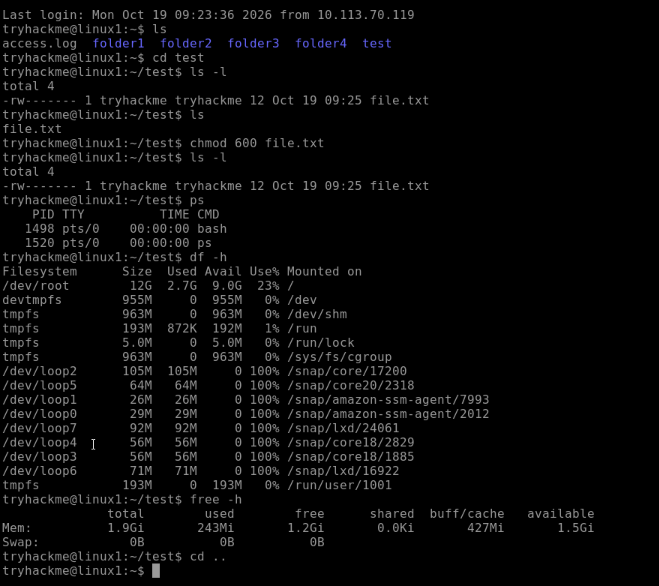

# Linux Commands Lab (TryHackMe: Linux Fundamentals )

Practiced basic Linux commands in a TryHackMe lab machine.  

## Commands I ran
1. `whoami`: shows which user I am
2. `pwd`: shows my current location
3. `ls`: lists files and folders
4. `mkdir test`: creates a folder called test
5. `cd test`: moves into the folder
6. `echo "hello" > file.txt`: writes text to a file (overwrites it)
7. `echo "world" >> file.txt`: adds text to the end of the file
8. `cat file.txt`: shows what is inside the file
9. `grep "hello" file.txt`: searches the file for matching text
10. `ls -l`: lists files with permissions, owner, size, and date
11. `chmod 600 file.txt`: only I can read and write the file
12. `ls -l`: checked the permissions again
13. `ps`: shows running processes
14. `df -h`: shows disk space
15. `free -h`: shows memory usage
16. `cd`: returns to my home folder

## What I learned
- `>` overwrites a file, `>>` adds to the end. I mixed them up at first and saw "world" replace "hello".
- `chmod 600` changed the permissions from `-rw-rw-r--` to `-rw-------`.
- `grep` searches inside files, which will be useful for reading logs.

## Screenshots

